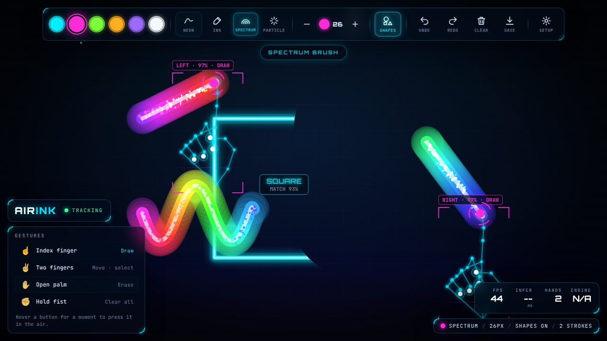
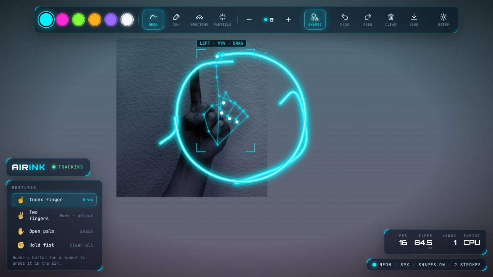

# AirInk: draw in the air

AirInk watches your hand through the webcam and turns the movement of your fingertip into glowing strokes on screen. Point to draw, show two fingers to move, open your palm to erase, and hold a fist to wipe the canvas.

Everything runs **on your device** in the browser: Google's MediaPipe hand-landmark model on WebAssembly, using the GPU where available. Your camera feed never leaves your computer, and there is no install, server or account.



<sub>Two hands drawing at once with the Spectrum brush. The square was drawn freehand and snapped to clean geometry.</sub>



<sub>Real detection on a camera feed: 21-point hand skeleton, depth-scaled joints, gesture tag and the stroke being drawn.</sub>

---

## Quick start

You need [Node.js](https://nodejs.org) 18 or newer and a webcam.

```bash
npm start
```

Open **http://localhost:5173**, click **INITIALIZE** and allow camera access.

> Browsers only allow the camera on `https://` or `http://localhost`, so opening `index.html` directly from disk won't work. Any static server is fine, for example `python3 -m http.server 5173`.

No camera? Click **Continue without camera** to draw with a mouse, pen or touch. Every other feature, including smart shapes, still works.

### Put it online (free)

The app is plain static files, so GitHub Pages can host it as is:
**Settings → Pages → Deploy from a branch → `main` / root**.
Pages serves over HTTPS, so the camera works there too.

---

## Gestures

| Gesture | Action |
|---|---|
| ☝️ **Index finger up** | **Draw** |
| ✌️ **Index + middle up** | **Move / select**: the pen lifts and the cursor follows your finger |
| ✋ **Open palm** | **Erase**: the eraser scales with how close your hand is to the camera |
| ✊ **Hold a fist** (1.2 s) | **Clear the canvas**: a progress ring fills first, and it can be undone |
| 🤏 **Pinch** *(optional mode)* | Draw only while thumb and index touch. Switch to it in **Setup** |

**Pressing buttons in the air:** hold the cursor over any toolbar button for about 0.6 s. A ring fills, then the button fires. Holding over Undo, Redo or Size keeps repeating.

Up to **two hands** are tracked at once, each with its own pen.

## Features

- **Real-time hand tracking**: 21 landmarks per hand from MediaPipe Hand Landmarker, running on the GPU through WebGL with an automatic CPU fallback.
- **Rotation-invariant gesture engine**: fingers are classified from 3-D joint angles and their reach from the wrist, not from "tip above knuckle" screen tests, so it works with tilted and sideways hands. It is tested against real MediaPipe output.
- **Jitter-free strokes**: a One Euro filter (adaptive low-pass) smooths fingertip noise when you move slowly and keeps lag low when you move fast.
- **Crisp stroke starts and ends**: gestures are confirmed over a few frames, then the stroke is backfilled to the moment the gesture began and the tail recorded during a gesture change is trimmed. Erase and clear need a longer hold, so a one-frame misread can never wipe your work.
- **Smart shapes**: draw a rough circle, ellipse, line, triangle, rectangle or square and it morphs into clean geometry with a match score. Recognition fits an ellipse and a polygon to the stroke and keeps whichever fits better.
- **Four brushes**:
  - **Neon**: layered glow.
  - **Ink**: line width follows your speed.
  - **Spectrum**: the colour shifts along the stroke.
  - **Particle**: glowing sparks.

  Six colours, seven sizes.
- **HUD**:
  - Hand skeleton with depth-scaled joints and targeting brackets.
  - Live gesture tag on each hand.
  - FPS, inference time and engine readout.
  - Particle effects.
  - Three camera styles: *Clear*, *Hologram* and *Void*.
- **Undo / redo** for strokes, erasing and clears. **Save as PNG** saves the drawing composited over the camera frame.
- **Brief tracking dropouts** (under 180 ms) don't break a stroke.

## Keyboard shortcuts

| Key | Action | Key | Action |
|---|---|---|---|
| `Z` / `Ctrl+Z` | Undo | `G` | Toggle smart shapes |
| `Y` / `Ctrl+Shift+Z` | Redo | `B` | Next brush |
| `C` | Clear | `1`–`6` | Colour |
| `S` | Save PNG | `[` `]` | Brush size |
| `H` | Cycle camera style | `K` | Toggle skeleton |

---

## How it works

```
 webcam ──► MediaPipe Hand Landmarker ──► 21 landmarks / hand (GPU, ~5–15 ms)
                                              │
                    ┌─────────────────────────┴───────────────────────┐
                    ▼                                                 ▼
          gesture analysis                                  fingertip / palm point
   (joint angles + reach, pinch hysteresis)               (One Euro filter → screen px)
                    │                                                 │
                    ▼                                                 │
          intent stabiliser ─────── DRAW / HOVER / ERASE / CLEAR ─────┤
   (multi-frame confirmation,                                         │
    stricter for destructive actions)                                 ▼
                                                  board: strokes, eraser, undo stack
                                                                      │
                                    stroke ends ──► smart-shape recogniser ──► morph animation
```

| File | Role |
|---|---|
| `src/tracker.js` | Loads MediaPipe (WASM and model from CDN), GPU→CPU fallback, per-frame detection |
| `src/gestures.js` | Finger-state classification, poses → intents, pinch hysteresis, intent stabiliser |
| `src/filters.js` | One Euro filter |
| `src/shapes.js` | Shape recognition (RDP polygon fit vs. ellipse fit, rectangle squaring, line snapping) |
| `src/board.js` | Stroke model, cached render layer, morph animations, undo/redo |
| `src/brushes.js` | Neon / Ink / Spectrum / Particle / eraser renderers |
| `src/hud.js` | Hand skeleton, targeting brackets and cursors |
| `src/effects.js` | Particles, shockwaves, floating labels |
| `src/main.js` | App wiring: boot, hand matching, dwell buttons, settings, frame loop |

There's no build step and no dependencies. It's plain ES modules.

## Tests

```bash
npm test
```

There are 38 unit tests, all runnable in Node with no install:

- **Gesture classification** on real landmark data that MediaPipe extracted from photos of a pointing finger, a peace sign, a fist, a thumbs-up and open palms (`tests/fixtures/hands.json`), plus a rotated-hand check.
- **Shape recognition** on noisy, hand-drawn-style synthetic strokes: circles (closed, overshooting, unclosed), ellipses, squares vs. circles, rotated rectangles, triangles and lines. Scribbles, arcs and U-shapes are correctly left alone.
- **Filtering and debouncing**: One Euro jitter suppression and lag, pinch hysteresis, intent confirmation.

## Troubleshooting

- **Laggy or no tracking on some GPUs:** add `?cpu` to the URL (`http://localhost:5173/?cpu`) to force the CPU engine.
- **Camera blocked:** click the camera icon in the address bar, allow access, then press **RETRY**.
- **Shaky lines:** pick **Silky** under **Setup → Stroke smoothing**, and make sure your hand is well lit.
- **Strokes start when you don't want them to:** switch **Setup → Draw trigger** to **Pinch**, which is more deliberate.
- **Smart shapes getting in the way:** toggle **SHAPES** in the toolbar, or press `G`.

## Privacy

Video frames go straight from your camera to the on-device model and are never uploaded. The only network requests are for the MediaPipe library, its WebAssembly runtime, the 7.8 MB hand model (jsDelivr / Google Storage) and the web fonts.
